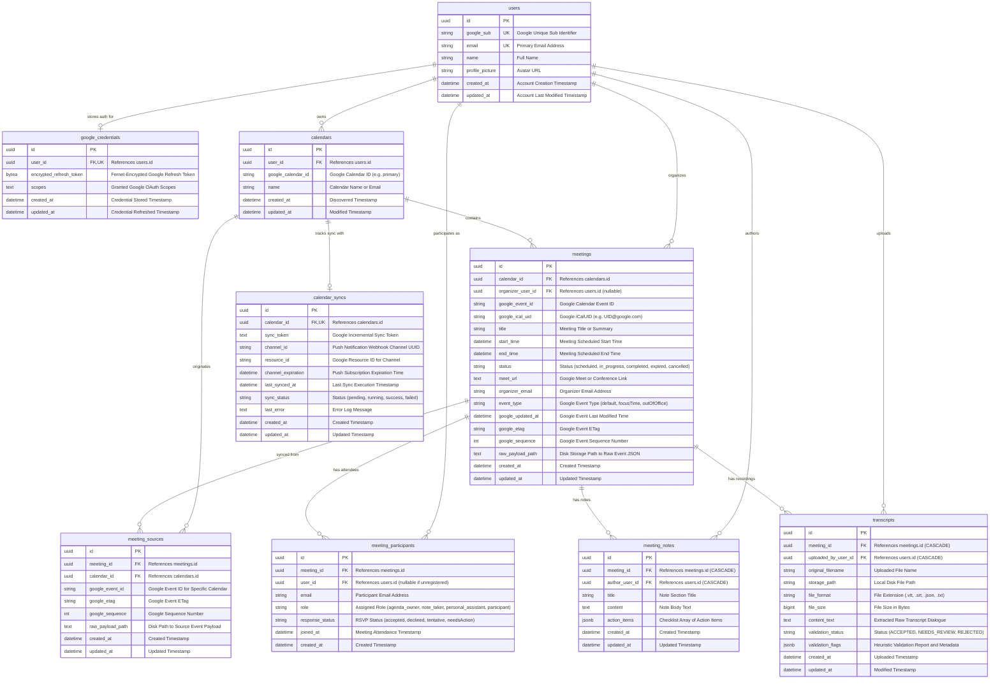

# MeetSync — Database Schema & Entity-Relationship (ER) Specification

## 1. Overview & Architectural Principles

The MeetSync database is built on **PostgreSQL** using **SQLAlchemy 2.0** declarative ORM models with native `UUID` and `JSONB` data types. It serves as the single source of truth for user identities, synchronized Google Calendar events, workspace rosters, collaborative meeting notes with interactive action items, and deterministic transcript validation records.

### Core Database Design Principles
1. **Universal UUID Primary Keys:** All entities utilize client-independent UUIDv4 primary keys (`as_uuid=True`), eliminating sequential ID prediction vulnerabilities and simplifying distributed data insertion.
2. **Strict Timezone-Aware Timestamps:** All datetime columns (`start_time`, `end_time`, `created_at`, `updated_at`, etc.) are defined with `DateTime(timezone=True)` using UTC to prevent scheduling discrepancies across global timezones.
3. **Foreign Key Integrity with Targeted Cascade Deletions:** Critical meeting child entities (`meeting_notes`, `transcripts`) define `ondelete="CASCADE"`, ensuring that when a meeting is permanently expunged, all associated notes, action items, and transcript metadata are purged cleanly without orphan records.
4. **Hybrid Relational & JSONB Storage:** Highly structured entities use standard relational columns with foreign keys, while dynamic, semi-structured data—such as note action items and multi-attribute transcript heuristic validation flags—are stored in PostgreSQL `JSONB` columns for fast indexing and schema flexibility.
5. **Idempotent Synchronization Constraints:** Unique composite constraints (such as `(google_ical_uid, start_time)` on `meetings` and `(calendar_id, google_event_id)` on `meeting_sources`) prevent duplicate meeting entries during recurring Google Calendar background synchronization.

---

## 2. Entity-Relationship (ER) Diagram

---

## 3. Data Dictionary & Table Specifications

### 3.1. `users` Table
Stores registered MeetSync user accounts created through Google OAuth authentication.

| Column | Type | Nullable | Default | Constraints & Description |
| :--- | :--- | :---: | :---: | :--- |
| `id` | `UUID` | No | `uuid.uuid4` | **Primary Key**. |
| `google_sub` | `String` | No | - | **Unique**. Google account identifier from OAuth userinfo token. |
| `email` | `String` | No | - | **Unique**. User's primary email address (case-insensitive indexing). |
| `name` | `String` | No | - | Display name of the user from Google Profile. |
| `profile_picture` | `String` | Yes | `None` | URL pointing to Google user profile avatar image. |
| `created_at` | `DateTime(tz=True)` | No | `now(utc)` | Timestamp when the user registered. |
| `updated_at` | `DateTime(tz=True)` | No | `now(utc)` | Timestamp when profile information was last synchronized. |

---

### 3.2. `google_credentials` Table
Stores symmetrically encrypted Google OAuth 2.0 refresh tokens at rest.

| Column | Type | Nullable | Default | Constraints & Description |
| :--- | :--- | :---: | :---: | :--- |
| `id` | `UUID` | No | `uuid.uuid4` | **Primary Key**. |
| `user_id` | `UUID` | No | - | **Foreign Key** (`users.id`), **Unique**. One-to-one with user. |
| `encrypted_refresh_token` | `LargeBinary` | No | - | Fernet-encrypted binary bytes of the Google OAuth refresh token. |
| `scopes` | `Text` | No | - | Space-separated list of approved Google API OAuth scopes. |
| `created_at` | `DateTime(tz=True)` | No | `now(utc)` | Timestamp when credential was stored. |
| `updated_at` | `DateTime(tz=True)` | No | `now(utc)` | Timestamp when credential was refreshed. |

---

### 3.3. `calendars` Table
Stores Google Calendars connected to users for synchronization.

| Column | Type | Nullable | Default | Constraints & Description |
| :--- | :--- | :---: | :---: | :--- |
| `id` | `UUID` | No | `uuid.uuid4` | **Primary Key**. |
| `user_id` | `UUID` | No | - | **Foreign Key** (`users.id`). The user who connected the calendar. |
| `google_calendar_id` | `String` | No | - | Identifier in Google Calendar (e.g., `'primary'` or email address). |
| `name` | `String` | No | - | User-friendly calendar name. |
| `created_at` | `DateTime(tz=True)` | No | `now(utc)` | Discovery timestamp. |
| `updated_at` | `DateTime(tz=True)` | No | `now(utc)` | Last updated timestamp. |

- **Table Constraints:** `UniqueConstraint("user_id", "google_calendar_id", name="uq_calendar_user_google_id")`.

---

### 3.4. `calendar_syncs` Table
Tracks real-time and incremental synchronization states and webhook push subscriptions per calendar.

| Column | Type | Nullable | Default | Constraints & Description |
| :--- | :--- | :---: | :---: | :--- |
| `id` | `UUID` | No | `uuid.uuid4` | **Primary Key**. |
| `calendar_id` | `UUID` | No | - | **Foreign Key** (`calendars.id`), **Unique**. 1:1 state mapping. |
| `sync_token` | `Text` | Yes | `None` | Google incremental sync token for delta event queries. |
| `channel_id` | `String` | Yes | `None` | **Indexed**. UUID identifying the active Google webhook subscription. |
| `resource_id` | `String` | Yes | `None` | Opaque identifier returned by Google Calendar push watch. |
| `channel_expiration` | `DateTime(tz=True)` | Yes | `None` | Expiration date of the Google push notification watch channel. |
| `last_synced_at` | `DateTime(tz=True)` | Yes | `None` | Timestamp of the most recent successful synchronization. |
| `sync_status` | `String` | No | `'pending'` | Current sync status: `'pending'`, `'running'`, `'success'`, `'failed'`. |
| `last_error` | `Text` | Yes | `None` | Error trace message if the last sync pass failed. |
| `created_at` | `DateTime(tz=True)` | No | `now(utc)` | Creation timestamp. |
| `updated_at` | `DateTime(tz=True)` | No | `now(utc)` | Last state modification timestamp. |

---

### 3.5. `meetings` Table
Central meeting table representing logical meeting sessions.

| Column | Type | Nullable | Default | Constraints & Description |
| :--- | :--- | :---: | :---: | :--- |
| `id` | `UUID` | No | `uuid.uuid4` | **Primary Key**. |
| `calendar_id` | `UUID` | No | - | **Foreign Key** (`calendars.id`). Calendar where event was created. |
| `organizer_user_id` | `UUID` | Yes | `None` | **Foreign Key** (`users.id`). User ID of the organizer if registered. |
| `google_event_id` | `String` | No | - | Google Calendar Event ID string. |
| `google_ical_uid` | `String` | Yes | `None` | Globally unique iCalUID string (persists across invitees). |
| `title` | `String` | No | - | Meeting title or topic summary. |
| `start_time` | `DateTime(tz=True)` | No | - | Scheduled meeting start time (UTC). |
| `end_time` | `DateTime(tz=True)` | No | - | Scheduled meeting end time (UTC). |
| `meet_url` | `Text` | Yes | `None` | Google Meet or video conferencing link. |
| `organizer_email` | `String` | Yes | `None` | Email address of the meeting organizer. |
| `event_type` | `String` | No | `'default'` | Event type: `'default'`, `'focusTime'`, `'outOfOffice'`. |
| `google_updated_at` | `DateTime(tz=True)` | Yes | `None` | Last modified timestamp from Google Calendar. |
| `google_etag` | `String` | Yes | `None` | HTTP ETag identifier for caching from Google. |
| `google_sequence` | `Integer` | Yes | `None` | Revision sequence number from Google Calendar. |
| `status` | `String` | No | `'scheduled'` | Meeting status: `'scheduled'`, `'cancelled'`. |
| `raw_payload_path` | `Text` | Yes | `None` | File path on disk to the raw Google Calendar JSON event payload. |
| `created_at` | `DateTime(tz=True)` | No | `now(utc)` | Record creation timestamp. |
| `updated_at` | `DateTime(tz=True)` | No | `now(utc)` | Record modification timestamp. |

- **Table Constraints:** `UniqueConstraint("google_ical_uid", "start_time", name="uq_meeting_ical_uid_start_time")`.

---

### 3.6. `meeting_participants` Table
Roster of meeting attendees with per-meeting Role-Based Access Control (RBAC) designations.

| Column | Type | Nullable | Default | Constraints & Description |
| :--- | :--- | :---: | :---: | :--- |
| `id` | `UUID` | No | `uuid.uuid4` | **Primary Key**. |
| `meeting_id` | `UUID` | No | - | **Foreign Key** (`meetings.id`). Associated meeting. |
| `user_id` | `UUID` | Yes | `None` | **Foreign Key** (`users.id`). `None` if attendee has not yet registered. |
| `email` | `String` | No | - | Attendee email address. |
| `role` | `String` | No | `'participant'` | Active role: `'agenda_owner'`, `'note_taker'`, `'personal_assistant'`, `'participant'`. |
| `response_status` | `String` | Yes | `None` | Google RSVP response: `'accepted'`, `'declined'`, `'tentative'`, `'needsAction'`. |
| `joined_at` | `DateTime(tz=True)` | Yes | `None` | Timestamp when attendee joined the active meeting call. |
| `created_at` | `DateTime(tz=True)` | No | `now(utc)` | Record creation timestamp. |

- **Table Constraints:** `UniqueConstraint("meeting_id", "email", name="uq_meeting_participant_email")`.

---

### 3.7. `meeting_notes` Table
Collaborative meeting notes authored by the designated Note Taker.

| Column | Type | Nullable | Default | Constraints & Description |
| :--- | :--- | :---: | :---: | :--- |
| `id` | `UUID` | No | `uuid.uuid4` | **Primary Key**. |
| `meeting_id` | `UUID` | No | - | **Foreign Key** (`meetings.id`, `ondelete="CASCADE"`). |
| `author_user_id` | `UUID` | No | - | **Foreign Key** (`users.id`, `ondelete="CASCADE"`). User who wrote the note. |
| `title` | `String(255)` | No | - | Section or note title. |
| `content` | `Text` | No | - | Full text content of the meeting note. |
| `action_items` | `JSONB` | No | `list` (`[]`) | Structured action items array. Each item: `{description, assignee_email, is_completed, due_date}`. |
| `created_at` | `DateTime(tz=True)` | No | `now(utc)` | Creation timestamp. |
| `updated_at` | `DateTime(tz=True)` | No | `now(utc)` | Last edited timestamp. |

- **Table Indexes:** `Index("ix_meeting_notes_meeting_id", "meeting_id")`, `Index("ix_meeting_notes_created_at", "created_at")`.

---

### 3.8. `transcripts` Table
Meeting audio or text recordings uploaded by the Note Taker, complete with heuristic validation audit reports.

| Column | Type | Nullable | Default | Constraints & Description |
| :--- | :--- | :---: | :---: | :--- |
| `id` | `UUID` | No | `uuid.uuid4` | **Primary Key**. |
| `meeting_id` | `UUID` | No | - | **Foreign Key** (`meetings.id`, `ondelete="CASCADE"`). |
| `uploaded_by_user_id` | `UUID` | No | - | **Foreign Key** (`users.id`, `ondelete="CASCADE"`). Uploader user ID. |
| `original_filename` | `String(255)` | No | - | Original uploaded file name (e.g. `'call_recording.vtt'`). |
| `storage_path` | `String(1024)` | No | - | Local disk file path where raw file is stored. |
| `file_format` | `String(50)` | No | - | File extension: `'.vtt'`, `'.srt'`, `'.json'`, `'.txt'`. |
| `file_size` | `BigInteger` | No | - | File size in bytes (maximum 25MB enforced). |
| `content_text` | `Text` | No | - | Full plain text dialogue extracted from the transcript file. |
| `validation_status` | `String(50)` | No | `'ACCEPTED'` | Heuristic status: `'ACCEPTED'`, `'NEEDS_REVIEW'`, `'REJECTED'`. |
| `validation_flags` | `JSONB` | No | `dict` (`{}`) | Detailed validation report: `{participant_mismatch, timestamp_match, format_valid, detected_speakers, warnings, word_count, details}`. |
| `created_at` | `DateTime(tz=True)` | No | `now(utc)` | Upload timestamp. |
| `updated_at` | `DateTime(tz=True)` | No | `now(utc)` | Last modified timestamp. |

- **Table Indexes:** `Index("ix_transcripts_meeting_created", "meeting_id", "created_at")`, `Index("ix_transcripts_validation_status", "validation_status")`.

---

### 3.9. `meeting_sources` Table
Maintains mapping when a single logical meeting event appears across multiple invitees' Google Calendars.

| Column | Type | Nullable | Default | Constraints & Description |
| :--- | :--- | :---: | :---: | :--- |
| `id` | `UUID` | No | `uuid.uuid4` | **Primary Key**. |
| `meeting_id` | `UUID` | No | - | **Foreign Key** (`meetings.id`). Associated logical meeting. |
| `calendar_id` | `UUID` | No | - | **Foreign Key** (`calendars.id`). Calendar containing this source instance. |
| `google_event_id` | `String` | No | - | Calendar-specific Google Event ID. |
| `google_etag` | `String` | Yes | `None` | ETag string for delta checking. |
| `google_sequence` | `Integer` | Yes | `None` | Revision sequence number. |
| `raw_payload_path` | `Text` | Yes | `None` | Local disk path to this specific source instance JSON payload. |
| `created_at` | `DateTime(tz=True)` | No | `now(utc)` | Record creation timestamp. |
| `updated_at` | `DateTime(tz=True)` | No | `now(utc)` | Record update timestamp. |

- **Table Constraints:** `UniqueConstraint("calendar_id", "google_event_id", name="uq_meeting_source_calendar_event")`.

---

## 4. Relational Cardinalities & Business Invariants

1. **User to Credentials (`1 : 0..1`):** Each user has at most one active Google OAuth credential record storing their encrypted refresh token.
2. **User to Calendars (`1 : 0..N`):** A user can connect multiple Google Calendars (primary, secondary, team).
3. **Calendar to Calendar Sync State (`1 : 1`):** Every calendar has exactly one synchronization state record tracking sync tokens and push webhook channels.
4. **Meeting to Participants (`1 : 1..N`):** Every meeting has one or more attendees. Exactly one attendee holds `agenda_owner`, at most one holds `note_taker`, at most one holds `personal_assistant`, and any remaining attendees hold `participant`.
5. **Meeting to Notes (`1 : 0..N`):** A meeting may have zero or multiple note sections, with cascade deletion enabled.
6. **Meeting to Transcripts (`1 : 0..N`):** A meeting may have zero or multiple uploaded transcript recordings, with cascade deletion enabled.
7. **Meeting to Meeting Sources (`1 : 1..N`):** A logical meeting (matched by `google_ical_uid` and `start_time`) can link back to multiple source calendar event IDs if multiple attendees connect their Google accounts.
8. **Participant to User Optionality (`0..1 : 1`):** A `meeting_participants` record can exist before the attendee registers on MeetSync (`user_id = None`). Once that user signs in with Google, their `user_id` is automatically retroactively linked.

