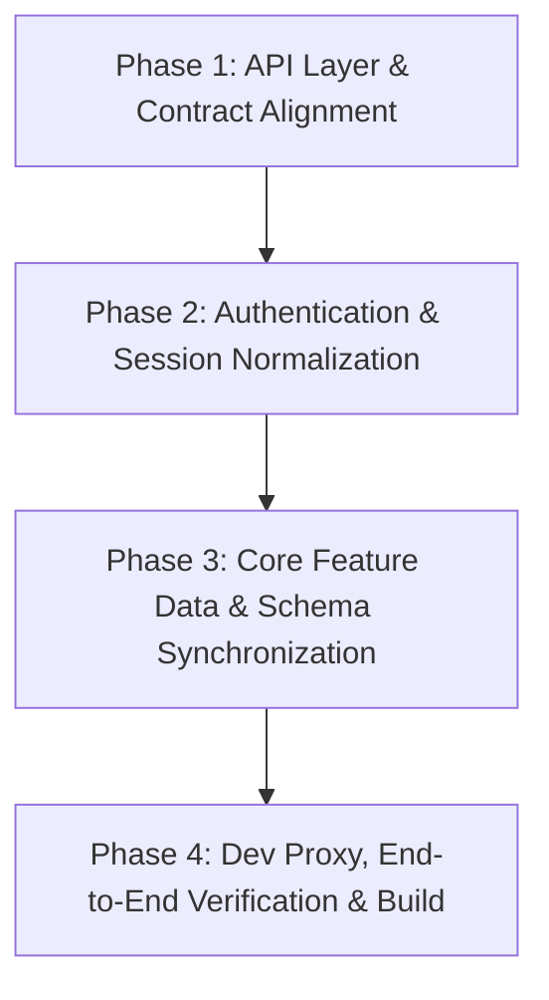

# MeetSync: Frontend & Backend Integration Plan

This implementation plan outlines the systematic integration of the React 19 + Vite frontend with the existing FastAPI backend.

> [!IMPORTANT]
> **Strict Integration Boundary Policy**:
> - No backend endpoints or schemas will be modified or added without prior approval.
> - All integration adaptations, path normalizations, payload unwrapping, and data mappings will be executed in the **frontend layer**.

---

## 1. Executive Summary & Architectural Alignment

### 1.1. Current State
* **Frontend**: React 19, Vite 8, Tailwind CSS, TanStack Query v5, Lucide React icons.
* **Backend**: FastAPI, SQLAlchemy (PostgreSQL), Pydantic v2, Alembic migrations, HttpOnly cookie sessions (`meetsync_session`).
* **Current Issue**: The frontend was developed against an offline mock engine. While it builds cleanly with zero errors (`npm run build`), several API routes and payload contracts diverge from the FastAPI endpoints.

### 1.2. Key Integration Objectives
1. Adapt frontend API service clients to match the backend's `/api/meetings/{meeting_id}/...` resource paths.
2. Unpack backend envelope responses (`NoteListResponse`, `TranscriptListResponse`) into UI-consumable data collections.
3. Bridge naming conventions between database models (`original_filename`, `file_format`, `validation_status`) and frontend views.
4. Harmonize authentication session restoration (`/api/auth/me`), Google OAuth URL redirection, and logout handling.
5. Eliminate all mock data, test fixtures, and offline demo switches to communicate directly with the live FastAPI backend.

---

## 2. Four-Phase Integration Roadmap



---

### Phase 1: API Layer & Contract Alignment (Adapters & Endpoint Synchronization)

**Goal**: Fix routing mismatches in frontend API wrapper functions so requests map to FastAPI endpoints without encountering 404s or proxy passthrough failures.

#### 1. Notes API Service (`frontend/frontend/src/api/notes.js`)
* **Endpoint Correction**: Change flat `/notes/{id}` endpoints to meeting-scoped `/api/meetings/{meeting_id}/notes/{note_id}`:
  * `getMeetingNotes(meetingId)`: Call `GET /api/meetings/${meetingId}/notes`. Safely unwrap backend `NoteListResponse` envelope (`res?.notes || res`).
  * `createMeetingNote(meetingId, noteData)`: Call `POST /api/meetings/${meetingId}/notes`.
  * `getNoteById(meetingId, noteId)`: Call `GET /api/meetings/${meetingId}/notes/${noteId}`.
  * `updateNote(meetingId, noteId, updateData)`: Call `PATCH /api/meetings/${meetingId}/notes/${noteId}`.
  * `deleteNote(meetingId, noteId)`: Call `DELETE /api/meetings/${meetingId}/notes/${noteId}`.

#### 2. Transcripts API Service (`frontend/frontend/src/api/transcripts.js`)
* **Endpoint Correction**: Align with meeting-scoped backend paths:
  * `getMeetingTranscripts(meetingId)`: Call `GET /api/meetings/${meetingId}/transcripts`. Safely unwrap backend `TranscriptListResponse` envelope (`res?.transcripts || res`).
  * `uploadTranscript(meetingId, file)`: Multipart `POST /api/meetings/${meetingId}/transcripts` with `file` form-data field.
  * `getTranscriptById(meetingId, transcriptId)`: Call `GET /api/meetings/${meetingId}/transcripts/${transcriptId}`.
  * `getTranscriptText(meetingId, transcriptId)`: Call `GET /api/meetings/${meetingId}/transcripts/${transcriptId}/text` and extract `res?.content_text ?? res`.
  * `downloadTranscriptFile(meetingId, transcriptId, filename)`: Stream `GET /api/meetings/${meetingId}/transcripts/${transcriptId}/file` as binary blob.

#### 3. In-Memory Mock Adapter (`frontend/frontend/src/api/mockAdapter.js`)
* Update mock method signatures to accept the new `(meetingId, ...)` arguments to keep offline mock mode fully functional.

#### Target Files for Phase 1:
* `frontend/frontend/src/api/notes.js`
* `frontend/frontend/src/api/transcripts.js`
* `frontend/frontend/src/api/mockAdapter.js`

---

### Phase 2: Authentication, Session & User Model Normalization

**Goal**: Seamlessly connect Google OAuth redirect, HttpOnly cookie session restoration, and user identity across client components.

#### 1. User Profile Attribute Normalization (`frontend/frontend/src/features/auth/AuthContext.jsx`)
* Backend `GET /api/auth/me` returns `UserResponse`:
  ```json
  {
    "id": "uuid",
    "email": "user@example.com",
    "name": "Alex Mercer",
    "profile_picture": "https://..."
  }
  ```
* Provide a normalizer in `AuthContext` so components accessing either `user.name` / `user.full_name` or `user.profile_picture` / `user.avatar_url` resolve properly without missing initials or broken images.

#### 2. Google OAuth Initiation & Redirect (`frontend/frontend/src/features/auth/LoginPage.jsx`)
* Backend `GET /api/auth/google/login` returns:
  ```json
  {
    "authorization_url": "https://accounts.google.com/o/oauth2/auth?...",
    "state": "..."
  }
  ```
* On clicking "Sign in with Google", invoke `loginWithGoogle()` and perform a browser redirect to `authorization_url`. Google will redirect back to the app with the session cookie set.

#### 3. Client Logout Handling (`frontend/frontend/src/api/auth.js`)
* Clear client-side React Query cache, local storage state, and redirect to `/login`. Handle server-side logout gracefully without throwing uncaught exceptions.

#### Target Files for Phase 2:
* `frontend/frontend/src/api/auth.js`
* `frontend/frontend/src/features/auth/AuthContext.jsx`
* `frontend/frontend/src/features/auth/LoginPage.jsx`
* `frontend/frontend/src/components/layout/Header.jsx`

---

### Phase 3: Core Feature Data & Schema Synchronization

**Goal**: Update UI feature modules to pass meeting context and handle backend database representations.

#### 1. Notes & Action Items Management (`frontend/frontend/src/features/notes/NotesSection.jsx`)
* Update `updateMutation`, `deleteMutation`, and `handleToggleActionItem` to pass `meetingId` into API calls:
  ```javascript
  updateMutation.mutate({ meetingId, noteId: editingNote.id, data });
  deleteMutation.mutate({ meetingId, noteId });
  ```
* Ensure action items conform to PostgreSQL JSONB format:
  ```json
  [
    {
      "id": "act-1",
      "text": "Complete security audit",
      "assignee": "Alex Mercer",
      "completed": false
    }
  ]
  ```

#### 2. Transcripts Section & Detail Modal (`frontend/frontend/src/features/transcripts/`)
* **List Normalization (`TranscriptsSection.jsx`)**:
  * Normalize attributes:
    * Filename: `item.original_filename || item.filename`
    * Format: `item.file_format || item.format`
    * Status: `item.validation_status || item.status`
    * Created At: `item.created_at || item.uploaded_at`
* **Detail Viewer (`TranscriptDetailModal.jsx`)**:
  * Pass `meetingId` to `getTranscriptText(meetingId, transcript.id)`.
  * Support `TranscriptTextResponse` object (`{ content_text, word_count }`) in addition to plain text.
  * Pass `meetingId` to `downloadTranscriptFile(meetingId, transcript.id, filename)`.

#### 3. Meeting Details & Participant Role Governance (`frontend/frontend/src/features/meetings/MeetingDetailPage.jsx`)
* Verify `GET /api/meetings/{id}/details` response properly populates the consolidated views for agenda, participants, notes, and transcripts.
* Ensure `updateParticipantRole(meetingId, participantId, role)` correctly fires `PATCH /api/meetings/{meeting_id}/participants/{participant_id}/role` and handles optimistic updates and error rollbacks.

#### 4. Search & Assistant Archive (`frontend/frontend/src/features/search/SearchPage.jsx`)
* Confirm query parameters (`q`, `start_date`, `end_date`, `role`, `page`, `limit`) align with FastAPI's `MeetingSearchQuery`.

#### Target Files for Phase 3:
* `frontend/frontend/src/features/notes/NotesSection.jsx`
* `frontend/frontend/src/features/transcripts/TranscriptsSection.jsx`
* `frontend/frontend/src/features/transcripts/TranscriptDetailModal.jsx`
* `frontend/frontend/src/features/meetings/MeetingDetailPage.jsx`
* `frontend/frontend/src/features/search/SearchPage.jsx`

---

### Phase 4: Dev Proxy, End-to-End Verification & Build Validation

**Goal**: Validate the integrated application across development and production environments.

#### 1. Dev Proxy Validation (`frontend/frontend/vite.config.js`)
* Ensure Vite development server reverse-proxies `/api` requests to `http://localhost:8000` with cookies (`credentials: 'include'`).

#### 2. Dual-Mode Verification
* **Offline Mock Mode**: Verify the header toggle allows immediate offline testing with sample data.
* **Live Mode**: Verify that switching Mock Mode OFF connects to the live FastAPI backend with zero client runtime errors.

#### 3. Production Bundle Validation
* Execute `npm run build` from `frontend/frontend` to ensure 0 build or lint errors and verify optimized chunks in `dist/`.

#### Target Files for Phase 4:
* `frontend/frontend/vite.config.js`
* Test run & build verification

---

## 3. Scope & Backend Guardrail Confirmation

| Item | Frontend Changes | Backend Changes |
| :--- | :--- | :--- |
| **API Endpoints** | Synchronize calling URLs | None |
| **Data Schemas** | Add property normalizers & unwrappers | None |
| **Authentication** | Direct OAuth redirect & session restore | None |
| **Logout** | Client cache & state cleanup | Optional (subject to user approval) |
| **Static Serving** | Vite dev server proxy & production build | Optional (subject to user approval) |
